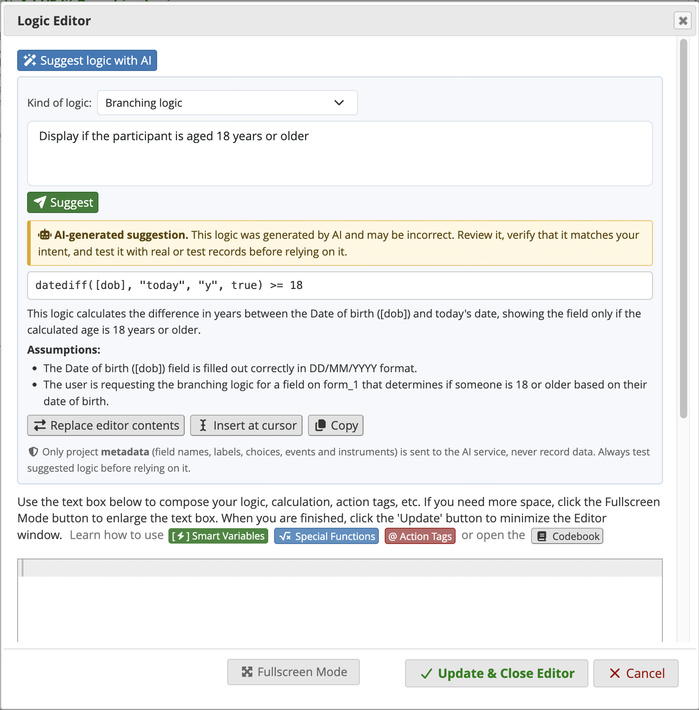

# REDCap Logic Assistant

This REDCap External Module adds an AI-powered assistant to REDCap's logic editor. Project designers describe the logic they need in plain language, such as *"show this field if the participant is over 65 and reported a fall at baseline"*. The module then suggests logic built from the project's own fields, choice codes, events and repeating instruments.



The assistant is available in every logic editor popup in a project. It knows the rules for each of the following kinds of logic:

- branching logic
- calculated fields
- `@CALCTEXT`, `@CALCDATE` and `@IF`
- report filters
- survey auto-invitation (ASI) conditions
- alerts
- Data Quality rules
- form display logic
- survey queue conditions
- survey auto-continue conditions
- calendar auto-scheduling triggers
- PDF Snapshot triggers
- randomisation triggers
- Record Status Dashboard filters
- MyCap participant conditions

Logic boxes not on this list still get the assistant, under "Other / not sure".

Each suggestion comes with:

- a plain-English explanation
- any assumptions the assistant made
- warnings, where relevant

Suggestions are never applied automatically. The user decides whether to use them.

**Only project metadata is sent to the AI service. No record data is ever sent.**

## Requirements

- REDCap 17.0.1 or later (External Module Framework version 17).
- A GenAI service configured in REDCap (**Control Center → GenAI Settings**): Azure OpenAI, an OpenAI-compatible endpoint, or Google Gemini.

The module uses whichever GenAI service is configured at the system level, or the project's override if one is set. If GenAI isn't enabled for a project, the assistant does not appear.

## Usage

Open the logic editor anywhere in a project where the module is enabled. For example, open a field's branching logic in the Online Designer and click into the logic box to bring up the **Logic Editor** dialogue. A **Suggest logic with AI** button appears above the editor.

1. Click **Suggest logic with AI** to open the assistant panel. The first time, a disclaimer is shown, which must be accepted. It covers what is sent to the AI service, the need to review and test suggestions, and not including sensitive information in requests. Acceptance is remembered for each REDCap user, in a browser cookie that includes their username, for one year.
2. Check the **Kind of logic** dropdown. The module automatically determines this from context, but the user may change it. It matters because the rules differ: a Data Quality rule is TRUE for the *problem*, a calculation must return a number, and so on.
3. Describe what you need, then click **Suggest** (or press Ctrl/Cmd+Enter). If the editor already contains logic, the assistant takes it into account, so you can also ask it to change existing logic, e.g. *"also exclude participants who withdrew"*.
4. Review the suggestion, explanation and any assumptions. Every suggestion is shown with a notice that it was generated by AI and must be reviewed, verified and tested. Then choose **Replace editor contents**, **Insert at cursor** or **Copy**.

If your request is ambiguous, or refers to something that doesn't exist in the project, the assistant asks a clarifying question instead of guessing.

Before any suggestion is shown, it is checked against the project:

- Every `[field]`, `[event_name]`, checkbox code and Smart Variable it references must exist.
- The logic must parse with REDCap's own logic parser.

If the check fails, the problems are sent back to the assistant for up to two corrected attempts. Anything still wrong is listed under **Check before using**.

**Always test suggested logic before relying on it.** Logic can pass these checks and still not do what you intended.

### What is sent to the AI service

Each request includes:

- The project's **metadata**:
  - the record ID field
  - instruments
  - events and arms, and which instruments are designated to each event
  - repeating instrument and event settings
  - fields, with their type, validation, label and choice codes
- Any logic already in the editor.
- The user's request.
- Any project-specific guidance (see below).

In Draft Mode, the draft version of the fields is sent.

**No record data is ever sent.**

On large projects, the metadata is trimmed to fit the configured size limit:

1. Choice labels are reduced to choice codes.
2. If it still doesn't fit, the assistant first makes a smaller request to the AI service to choose the instruments the request needs. That request sends only the instruments, their field names and short field labels, along with the request itself. The chosen instruments are then described in full. Other instruments list only their field names. Instruments named in the request or in the existing logic, and the instrument open in the Online Designer, are always included.
3. If the instruments can't be chosen this way, the instruments the request names are described in full instead.
4. If it still doesn't fit, the text is cut off. The instruments described in full come first, so the field-name lists are cut first.

Projects that fit within the limit are sent whole, with no extra request.

## Configuration

### System settings

| Setting | Default Value | Description |
| --- | --- | --- |
| Only show the assistant to users with Project Design and Setup rights | false | If checked, only users with Design rights (and super users) see the assistant. Otherwise, all project users who can open the logic editor see it, including on report and alert pages. |
| Maximum characters of project metadata sent per request | 60000 | Upper limit on the size of the project description sent with each request. Larger projects are trimmed as described above. |
| Daily AI token limit for the whole site | (no limit) | Total tokens, input and output, that the module may use per day across all projects. Blank or 0 means no limit. See [Usage limits](#usage-limits). |
| Daily AI token limit per project | (no limit) | Total tokens, input and output, that each project may use per day. Blank or 0 means no limit. See [Usage limits](#usage-limits). |

### Project settings

| Setting | Default Value | Description |
| --- | --- | --- |
| Project-specific guidance | | Optional notes added to every request from the project, e.g. *"Missing data is coded as -99"*, or *"The [group] field is populated by randomisation"*. |
| Daily AI token limit for this project | (system limit) | **Super users only.** Overrides the system-level per-project daily token limit for this project. Blank uses the system limit; 0 means no per-project limit. The site-wide limit still applies. |

### Usage limits

Each request can make up to three calls to the AI service: the first suggestion, and up to two corrections if it fails validation. On projects too large to send whole, there is one extra, smaller call first to choose the instruments needed. Each call includes the project's metadata, so a request on a large project can use tens of thousands of tokens.

To control cost, administrators can set two daily token limits, and both apply:

- **Site-wide:** the total for all projects on the REDCap site combined.
- **Per project:** the total for each project. Super users can override it for individual projects.

The module adds up the tokens recorded in its log since midnight, server time, for the project and for the whole site:

- Once either limit is reached, further requests are refused until the next day. The message says which limit was reached.
- If a limit is reached during a request, no further corrections are attempted. The suggestion so far is shown with a note saying so. A project, or the site, can therefore go over its limit by up to one request's usage.

Token counts are taken from the usage reported by the AI service. If the service doesn't report usage, the module estimates it at about four characters per token.

## Logging

Each request is recorded in the module's log with:

- the kind of logic requested
- the number of attempts
- whether the final suggestion passed validation
- whether the request completed or failed
- whether the project was sent whole or the instruments were chosen first
- the number of tokens used, which counts towards the daily limits
- which type of GenAI service was used (OpenAI or Gemini)

The text of the request and the generated logic are **not** logged.

Each call to the AI service is also recorded in REDCap's own AI log (`redcap_ai_log`), in the same way as REDCap's built-in AI features, with the type `LogicAssistant`. Core records only the service, project, user and character and word counts, not the text. These calls count towards REDCap's AI usage statistics.

## Limitations

- Errors from the AI service are shown to the user. Any other unexpected error is written to the server's PHP error log, and the user sees a generic message.
- The module relies on REDCap's internal AI classes to use the project's GenAI configuration. These are not part of the documented External Module Framework, so a future REDCap release could break the module until it is updated.
- The assistant is added by wrapping REDCap's own logic editor. If a future REDCap version substantially changes the logic editor, the assistant may not appear. The editor itself will continue to work normally.
- The module picks the kind of logic from the logic box that was opened. It recognises REDCap's own logic boxes by their element IDs, so if a future REDCap version renames one, it falls back to "Other / not sure". Check the **Kind of logic** dropdown before submitting. This in particular will affect custom logic editors added by External Modules.
- In the Online Designer, the assistant doesn't yet know which field's branching logic is being edited. Mention the field in your request if it matters.

## Citation

If you use this external module for a project that generates a research output, please cite this software in addition to [citing REDCap](https://projectredcap.org/resources/citations/) itself. You can do so using the APA referencing style as below:

> Wilson, A. (2026). REDCap Logic Assistant [Computer software]. https://github.com/jangari/redcap_logic_assistant

Or by adding this reference to your BibTeX database:

```bibtex
@software{Wilson_REDCap_Logic_Assistant_2026,
  title        = {{REDCap Logic Assistant}},
  author       = {Wilson, Aidan},
  year         = 2026,
  month        = 11,
  url          = {https://github.com/jangari/redcap_logic_assistant}
}
```

These instructions are also available in [GitHub](https://github.com/jangari/redcap_logic_assistant/) under 'Cite This Repository'.

## AI Involvement Declaration

The concept and requirements for this module were developed by Aidan Wilson. The initial implementation was written by Anthropic's Claude (Opus 5.5) via Claude Code, working from the author's direction. Design decisions were reviewed and tested by the author: relying on REDCap's existing GenAI configuration, sending metadata only, validating suggestions before display, and never applying them automatically.

## Changelog

| Version | Description |
| --- | --- |
| 1.0.0 | Initial release. |
